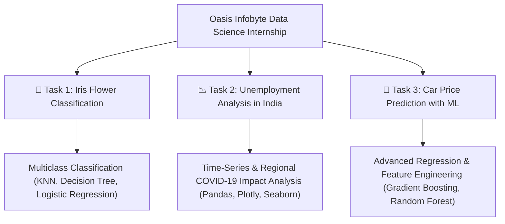

# 📊 Oasis Infobyte Data Science Internship (OIBSIP)

<p align="center">
  
  
  
  
  
</p>

This repository contains the data science and machine learning projects developed by **Kunal Nevage** during the **Oasis Infobyte Data Science Internship Program (OIBSIP)**. The repository covers classical supervised machine learning classification, macroeconomic exploratory data analysis (EDA), and regression-based automotive price prediction.

---

## 📚 Curriculum & Tasks Overview



---

## 🌸 Task 1: Iris Flower Classification

- **Folder**: [`DataScience-Task1-Iris/`](DataScience-Task1-Iris/)
- **Notebook**: [`KunalNevage_Task1.ipynb`](DataScience-Task1-Iris/KunalNevage_Task1.ipynb)
- **Objective**: Build a predictive machine learning model capable of accurately classifying iris flowers into their respective botanical species (*Iris setosa*, *Iris versicolor*, and *Iris virginica*) based on sepal and petal physical dimensions.
- **Methodology**:
  - Feature correlation and pair plots with Seaborn.
  - Train/test splitting with standard scaling.
  - Evaluated multiple classifiers (Logistic Regression, K-Nearest Neighbors, Decision Trees, and Random Forest).
  - Model evaluation with confusion matrices, precision, recall, and F1-scores.

---

## 📉 Task 2: Unemployment Analysis in India

- **Folder**: [`Task2_Unemployment_Analysis/`](Task2_Unemployment_Analysis/)
- **Notebook**: [`Unemployment_Analysis_Kunal.ipynb`](Task2_Unemployment_Analysis/Unemployment_Analysis_Kunal.ipynb)
- **Dataset**: `Unemployment_Rate_upto_11_2020.csv`
- **Objective**: Analyze the socio-economic and labor market impact of the **COVID-19 pandemic lockdowns** across Indian states during the year 2020.
- **Methodology**:
  - Data wrangling and date parsing of state-level monthly labor metrics.
  - Regional comparison of **Estimated Unemployment Rate (%)**, **Employed Labor Force**, and **Labor Participation Rate (%)**.
  - Identification of peak lockdown shockwaves (March–May 2020).
  - High-impact data visualizations using Plotly express animations, regional heatmaps, and trend lines.

---

## 🚗 Task 3: Car Price Prediction with Machine Learning

- **Folder**: [`Task3_Car_Price_Prediction/`](Task3_Car_Price_Prediction/)
- **Notebook**: [`Car_Price_Prediction_Kunal.ipynb`](Task3_Car_Price_Prediction/Car_Price_Prediction_Kunal.ipynb)
- **Script**: [`car_price_prediction.py`](Task3_Car_Price_Prediction/car_price_prediction.py)
- **Dataset**: `car_details.csv` (CarDekho Vehicle Dataset)
- **Objective**: Build a regression model that accurately predicts the resale selling price of used cars based on multi-dimensional vehicle attributes (brand, vehicle age, mileage, fuel type, transmission mechanism, seller type, and ownership tier).
- **Methodology**:
  - Comprehensive data cleaning (audited null values, purged 763 duplicate records, standardized categorical casing and whitespaces).
  - Domain feature engineering (`car_age` from reference year 2020, manufacturer `brand` extraction from car title, and `km_per_year` annual usage intensity).
  - Exploratory Data Analysis: Target price distribution (raw vs log-transformed), fuel type box plots, age depreciation scatter plots, and feature correlation heatmap.
  - One-Hot Encoding with rare-category consolidation and 80/20 train/test split.
  - Multi-model evaluation comparing Linear Regression, Ridge Regression, Random Forest Regressor, and Gradient Boosting Regressor across MAE, RMSE, and $R^2$.
  - Feature importance analysis identifying transmission type, vehicle age, and mileage intensity as primary price drivers.
  - Serialized model artifact (`best_car_price_model.joblib`) with production inference prototype.

---

## 🛠️ Tech Stack Used

| Domain | Libraries & Tools |
|---|---|
| **Language & Environment** | Python 3.10+, Jupyter Notebook |
| **Data Manipulation** | `pandas`, `numpy` |
| **Statistical Visualization** | `matplotlib`, `seaborn`, `plotly` |
| **Machine Learning** | `scikit-learn`, `joblib` |

---

## ⚙️ Installation & Running Notebooks

### 1. Clone the Repository
```bash
git clone https://github.com/kunalnevage10-lgtm/OIBSIP.git
cd OIBSIP
```

### 2. Set Up Virtual Environment
```bash
# Windows
python -m venv venv
.\venv\Scripts\activate

# macOS / Linux
python3 -m venv venv
source venv/bin/activate
```

### 3. Install Dependencies
```bash
pip install pandas numpy matplotlib seaborn plotly scikit-learn jupyterlab joblib
```

### 4. Launch Jupyter Notebook
```bash
jupyter lab
# or
jupyter notebook
```
Navigate to `DataScience-Task1-Iris`, `Task2_Unemployment_Analysis`, or `Task3_Car_Price_Prediction` and execute cells sequentially.

---

## 🛡️ License

This project is open-source under the [MIT License](LICENSE).
